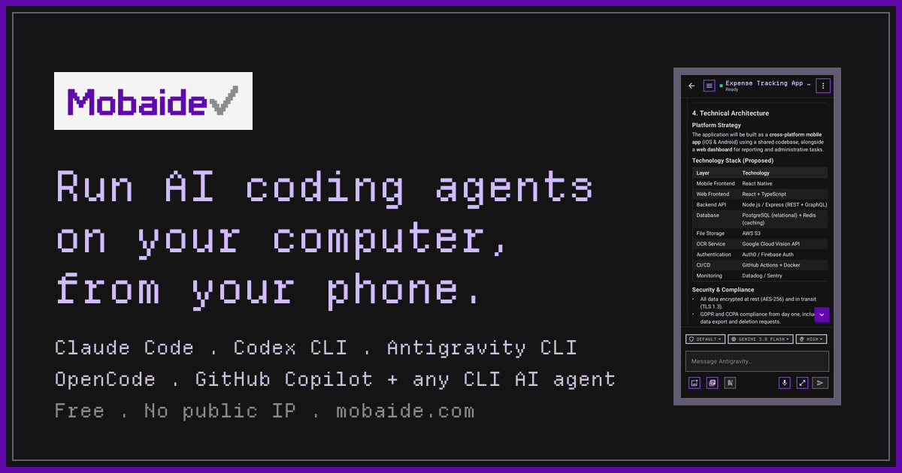
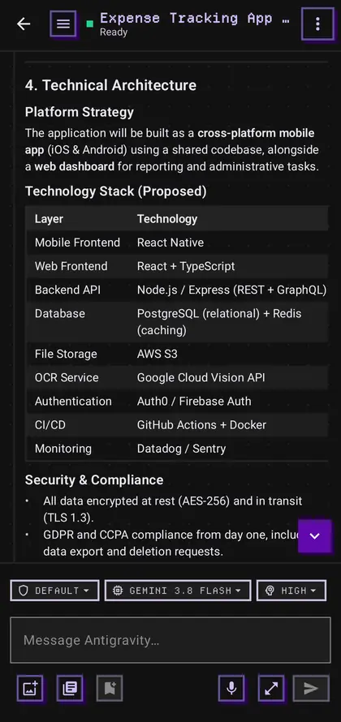
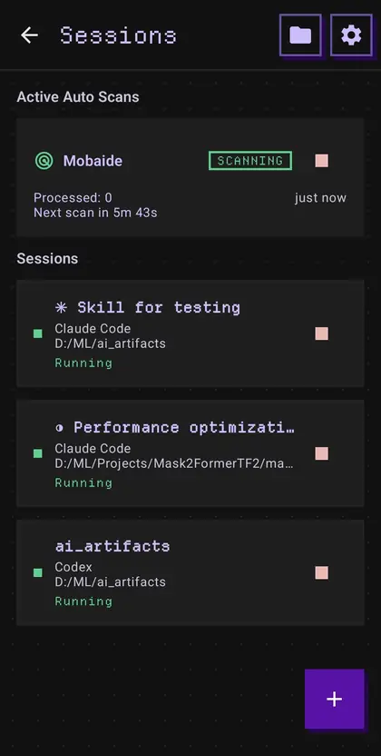
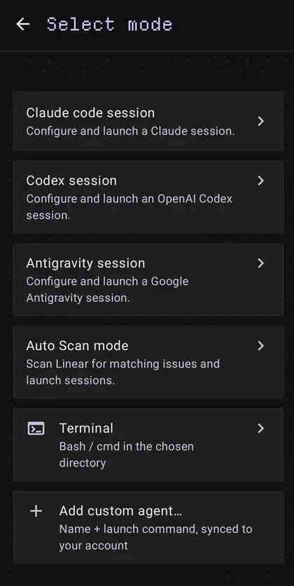
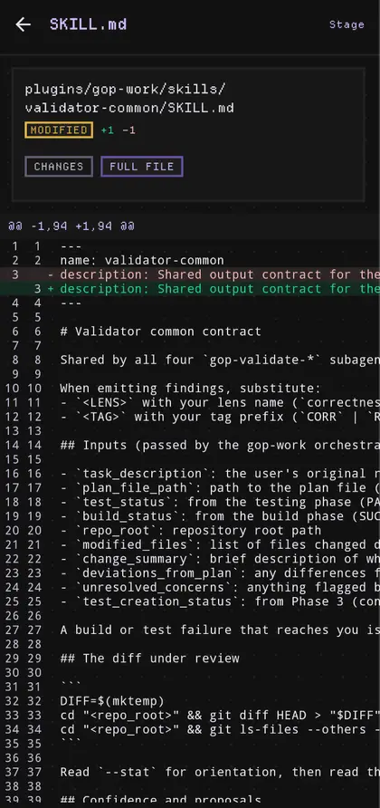
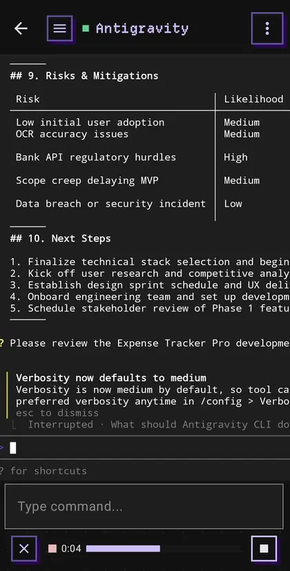
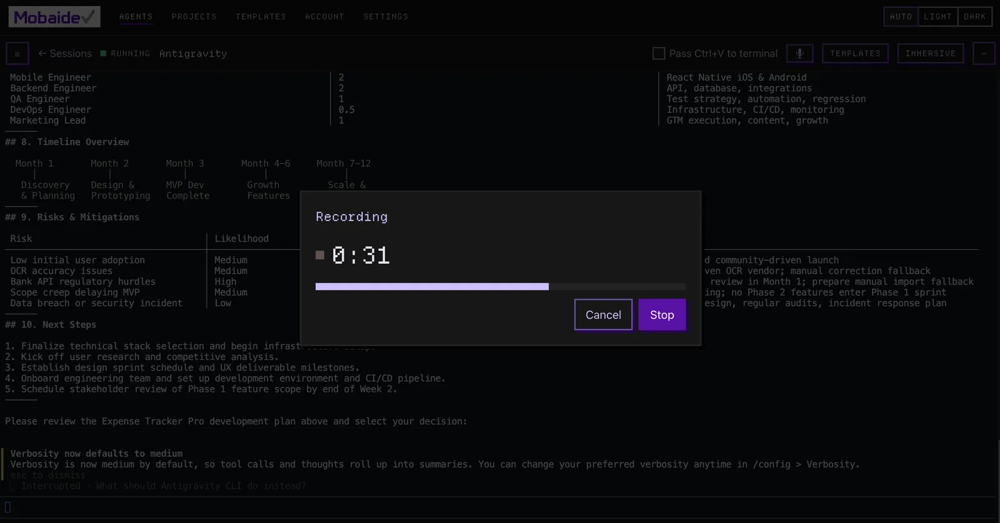

<h1 align="center">Mobaide</h1>

<p align="center">
  <a href="https://mobaide.com">
    
  </a>
</p>

<p align="center">
  Start, watch and steer <b>Claude Code</b>, <b>Codex CLI</b>, <b>Antigravity CLI</b>, <b>GitHub Copilot CLI</b> or your own agents<br>
  on your Windows, macOS or Linux computer, from your phone or browser.<br>
  Free. No public IP, port forwarding, VPN or SSH.
</p>

<p align="center">
  <a href="https://play.google.com/store/apps/details?id=com.mobaide.app"></a>
  &nbsp;
  <a href="https://apps.apple.com/app/id6797191741"></a>
</p>

<p align="center">
  <a href="https://mobaide.com"><b>Website</b></a> &nbsp;·&nbsp;
  <a href="https://app.mobaide.com"><b>Open the web app</b></a> &nbsp;·&nbsp;
  <a href="https://mobaide.com/voice-input"><b>Voice input</b></a> &nbsp;·&nbsp;
  <a href="https://mobaide.com/#faq"><b>FAQ</b></a> &nbsp;·&nbsp;
  <a href="https://github.com/syrax90/mobaide-community/discussions"><b>Community</b></a>
</p>

<table align="center">
  <tr>
    <td align="center"></td>
    <td align="center"></td>
    <td align="center"></td>
    <td align="center"></td>
  </tr>
  <tr>
    <td align="center"><sub>A live session, driven from the phone</sub></td>
    <td align="center"><sub>Several sessions at once</sub></td>
    <td align="center"><sub>Built-in agents, or your own</sub></td>
    <td align="center"><sub>Read every diff before you commit</sub></td>
  </tr>
</table>

## Features

- **A chat view built for the phone.** Claude Code, Codex, Antigravity and GitHub Copilot sessions open as a native chat: Markdown answers, one card per tool call with its diff, approval buttons, questions, plan progress, mode and model chips. It runs over the [Agent Client Protocol](https://agentclientprotocol.com), and it can continue a Claude Code, Codex, Antigravity or GitHub Copilot session you started in a terminal on your computer. Codex chats stay in sync with a session open in a terminal.
- **A real terminal, not a log tail.** Full two-way PTY, so TUIs behave: arrow keys, Ctrl-C, plan mode, approval prompts. A rolling buffer of recent output replays after a dropped connection. Claude Code, Codex, Antigravity and GitHub Copilot sessions offer it under Advanced as Terminal UI; raw shells and custom agents always use it.
- **Your agents, your options.** Launch Claude Code, Codex CLI or Antigravity CLI with their own model, effort, sandbox and approval settings, or GitHub Copilot CLI with its allow-all choice. Open a raw shell, or define an agent from any command your shell can run.
- **Several sessions at once.** Keep a Claude Code run, a Codex review and a shell side by side, each with its own state.
- **[Voice input](#voice-input).** Dictate prompts instead of thumb-typing them. Your own computer does the transcription, in 25 languages. Opt-in, and the audio is never stored.
- **Git from your phone.** Read diffs, stage, commit, fetch, pull, push, rebase, resolve conflicts and manage branches. Git runs on your machine, with the credentials it already has.
- **Optional Git worktrees.** Start any session in its own worktree so parallel runs do not collide. Opt-in per launch, Git projects only.
- **Auto Scan.** Watch [Linear](https://linear.app) for matching issues and launch a Claude Code session in a new worktree for each one.
- **Notifications.** Get an alert when a session needs your approval, finishes a turn or ends.
- **Prompt templates and shortcuts.** Save prompts and reuse them in any session. Build custom key chords as buttons on the mobile control bar. Both sync across your devices.
- **Set up once.** The agent installs as an OS service, restarts itself if it dies, and updates itself from signed releases.

See the [feature reference](docs/features.md) for the details.

## Voice input

Say your prompt instead of thumb-typing it. Your own computer turns the speech into text, and the text waits in the command field until you send it. Voice input works in the Android and iOS apps and in the browser, for every session kind.

<table align="center">
  <tr>
    <td align="center"></td>
    <td align="center"></td>
  </tr>
  <tr>
    <td align="center"><sub>Android</sub></td>
    <td align="center"><sub>Browser</sub></td>
  </tr>
</table>

- **Transcribed on your computer.** The agent runs NVIDIA's open Parakeet speech model on your CPU. It needs no GPU and no cloud speech service.
- **25 languages.** The model detects the language as you speak, so there is nothing to switch.
- **Never sent on its own.** You read the transcript, edit it and send it yourself, so a misheard word cannot become a command.
- **Nothing stored.** Audio streams over TLS through the relay, which routes it in memory. The relay and the agent never store or log the audio or the text.
- **Opt-in per computer.** Nothing downloads until you enable it. The download is about 0.7 GB, once. Transcription uses about 700 MB of memory, released after three idle minutes. You can remove voice input at any time.

Read more on the [voice input page](https://mobaide.com/voice-input): [how it works](https://mobaide.com/voice-input#how), [setup](https://mobaide.com/voice-input#setup), [requirements](https://mobaide.com/voice-input#requirements), [languages](https://mobaide.com/voice-input#languages), [privacy](https://mobaide.com/voice-input#privacy) and [FAQ](https://mobaide.com/voice-input#faq).

## Get started

**You need** a computer with at least one agent CLI installed and signed in. Mobaide launches the CLIs you already have. It does not resell or proxy any model provider. On macOS and Linux, the agent also needs Python 3.12+. The Windows installer gets Python for you.

**1. Install the agent** on the computer you want to reach.

```bash
# macOS / Linux
curl -fsSL https://get.mobaide.com/install.sh | bash
```

```powershell
# Windows (PowerShell)
irm https://get.mobaide.com/install.ps1 | iex
```

**2. Get a client and pair.** Install the [Android](https://play.google.com/store/apps/details?id=com.mobaide.app) (8.0+) or [iPhone](https://apps.apple.com/app/id6797191741) (iOS 17+) app, then scan the QR code the agent prints. In a browser, open the pairing link the agent prints and sign in at [app.mobaide.com](https://app.mobaide.com).

**3. Start a session.** Pick a project, pick what to run, and drive it from the chat view, or from the terminal view for shells and custom agents.

## How it works

The agent on your computer dials out to the relay, so it works behind any router, NAT or firewall, on mobile data or any Wi-Fi.

```text
  Phone or browser              Relay                  Your computer
┌──────────────────┐        ┌───────────┐        ┌──────────────────────┐
│  Android         │  WSS   │           │  WSS   │  Mobaide agent       │
│  iOS             ├───────►│ mobaide   │◄───────┤    │ PTY             │
│  Web             │        │   .com    │ dials  │    ▼                 │
│                  │        │           │  out   │  Claude Code, Codex, │
└──────────────────┘        └───────────┘        │  Antigravity,        │
                                                 │  GitHub Copilot,     │
                                                 │  shell               │
                                                 └──────────────────────┘
```

**Your data.** Going through the relay, every hop is TLS-encrypted (WSS). The relay terminates TLS, so this is transport encryption, not end-to-end encryption. Session traffic passes through its in-memory routing and is never written to its database, logs or backups. The relay does store what must sync across your devices: your account, paired devices, prompt templates, saved shortcuts and custom agent types.

The agent carries no analytics SDK. The mobile apps carry Google's Firebase Analytics for one purpose, telling Google Ads which installs went on to pair an agent, and it never sees your sessions. The [privacy policy](https://mobaide.com/privacy.html) lists every field.

## Repository

| Path | What |
|---|---|
| [`android/`](android) | Android app (Kotlin, Jetpack Compose) |
| [`ios/`](ios) | iOS app (Swift, SwiftUI) |
| [`web/`](web) | Web client (React, TypeScript) |
| [`mobaide_agent/`](mobaide_agent) | Agent for your computer (Python, FastAPI) |
| [`central_server/`](central_server) | Relay server and website (Python, FastAPI) |
| [`deploy/`](deploy) | Agent install scripts and deploy tooling |
| [`docs/`](docs/doc-list.md) | Documentation, indexed in [`doc-list.md`](docs/doc-list.md) |

Start with [architecture](docs/architecture.md), the [wire protocol](PROTOCOL.md), [deployment](docs/deployment.md), and [versioning and releases](docs/versioning-and-updates.md).

## Contributing

Bug fixes and improvements are welcome. [CONTRIBUTING.md](CONTRIBUTING.md) tells you how to set up the code, run the tests and open a pull request.

## Support

Ask questions in the [community discussions](https://github.com/syrax90/mobaide-community/discussions), or email [support@mobaide.com](mailto:support@mobaide.com).

## License

Mobaide is licensed under the [Apache License 2.0](LICENSE). See [NOTICE](NOTICE) for the copyright.

---

<sub>Developed by Pavel Timonin. Mobaide is an independent app and is not affiliated with or endorsed by Anthropic, OpenAI, Google, GitHub, Apple, NVIDIA or Linear. "Claude" and "Claude Code" are trademarks of Anthropic. "Codex" is a trademark of OpenAI. "Antigravity" is a trademark of Google. "GitHub" and "GitHub Copilot" are trademarks of GitHub, Inc. NVIDIA is a trademark of NVIDIA Corporation. Google Play and the Google Play logo are trademarks of Google LLC. Apple and the Apple logo are trademarks of Apple Inc., registered in the U.S. and other countries; App Store is a service mark of Apple Inc. All other trademarks are the property of their respective owners.</sub>
